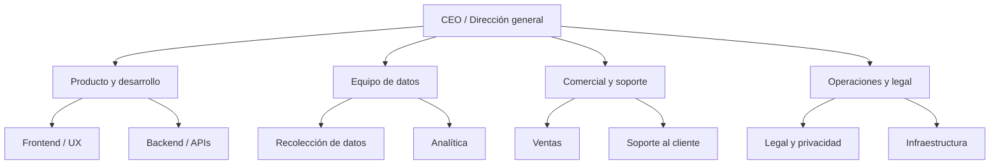

# 01 · Análisis y documentación inicial (RA1)

> **Plantilla.** Se entrega como **H1 el 26-nov-2026**. Cada apartado indica el criterio de evaluación (CE) que evidencia y qué se espera. Borra las notas en cursiva al rellenar.

## 1. Sector y empresas (CE 1a, 1b)

**Sector:** análisis de datos deportivos, concreto en fútbol. Empresas que proveen datos, métricas y herramientas de análisis de partidos a clubes, medios y particulares.

**Empresas candidatas** 

| # | Empresa | Tipo (organizativa) | Producto/servicio |
|---|---|---|---|
| 1 | Stats Perform (Opta) | Multinacional de datos deportivos | Datos y métricas de partidos, APIs |
| 2 | Wyscout | Plataforma SaaS de scouting | Vídeo y estadísticas de jugadores/partidos |
| 3 | Hudl | Plataforma de vídeo y análisis | Herramientas de análisis de vídeo para equipos |
| 4 | StatsBomb | Proveedor de datos avanzados | Eventos y métricas avanzadas (xG, etc.) |
| 5 | InStat | Plataforma de análisis de vídeo | Informes y vídeo de partidos |

**Empresa tipo (proveedor de datos deportivos):** organigrama genérico.

**Funciones de cada departamento:**
- **Dirección general:** estrategia, acuerdos con ligas y clubes.
- **Producto y desarrollo:** diseño y construcción de la plataforma (frontend, backend, APIs).
- **Equipo de datos:** recolección de eventos de partido, cálculo de métricas, calidad del dato.
- **Comercial y soporte:** ventas, onboarding, atención al cliente.
- **Operaciones y legal:** infraestructura, seguridad, cumplimiento (privacidad, licencias de datos).

## 2. Necesidades y oportunidades (CE 1c, 1d)

**Necesidades priorizadas** (criterio: impacto en el usuario final / frecuencia de uso; fuente: `00-documentoInicio.md`, sección 4):

| Prioridad | Necesidad | Fuente |
|---|---|---|
| 1 | Usabilidad: apps de análisis de partidos suelen ser complejas de entender y usar | 00-documentoInicio 4 |
| 2 | Integración de datos y estadísticas desde APIs y datasets | 00-documentoInicio 10 |
| 3 | Tiempo y recursos para desarrollar y desplegar el proyecto | 00-documentoInicio 10 |

**Oportunidades de negocio:** el sector de análisis deportivo crece con la demanda de datos por parte de clubes, medios y aficionados. **Pendiente:** añadir datos con fuente verificada (p. ej., tamaño del mercado de empresas de análisis deportivo). 

## 3. Tipo de proyecto elegido (CE 1e)

**Proyecto:** aplicación web de análisis de partidos de fútbol («MatchLens»), con enfoque en usabilidad y simplicidad para particulares y empresas.

**Por qué este y no otras alternativas:**
- **Web (elegido):** accesible desde navegador, sin instalación, encaja con los módulos de 2.º (cliente, servidor, despliegue, interfaces). Aprovecha conocimientos previos del ciclo. Se descarta app movil por desarrollo y contenido del ciclo y app de escritorio por alcance de usuarios 

## 4. Requisitos y restricciones (CE 1f)

**Propuesta inicial** (a validar; cada requisito con medida o prueba):

| ID | Requisito | Tipo | Cómo se verifica |
|---|---|---|---|
| RF-01 | El sistema permite consultar estadísticas de un partido (goles, tiros, posesión, etc.) | funcional | Prueba manual: se muestra la ficha del partido con los datos |
| RF-02 | El sistema permite filtrar/buscar partidos por equipo o fecha | funcional | Prueba manual: resultados correctos para un filtro dado |
| RF-03 | El sistema integra datos desde al menos una API o dataset externo | funcional | Prueba: datos cargados y visibles en la app |
| RF-04 | La interfaz muestra los datos de forma clara y simple (usabilidad) | funcional | Revisión con 3 usuarios: completan una tarea sin ayuda |
| RNF-01 | Tiempo de respuesta de una consulta en condiciones normales | no funcional | Medición con navegador / herramienta de red |
| RNF-02 | Diseño responsive (móvil y escritorio) | no funcional | Prueba en móvil y escritorio |
| RNF-03 | Accesibilidad básica (contraste, navegación por teclado) | no funcional | Revisión manual + Lighthouse |
| REST-01 | Entrega H1 el 26-nov-2026 y versión mínima funcionando antes del 31-mar | restricción | Calendario del curso |
| REST-02 | Tecnologías del ciclo (Java 21, Spring Boot, SQL) salvo razón argumentada | restricción | Revisión de código y decisiones |
| REST-03 | Sin datos personales reales; solo datos de ejemplo | restricción | Revisión de datos y repositorio |

### Matriz de trazabilidad

| Objetivo | Requisito | Caso de uso | Pantalla o endpoint | Prueba o indicador |
|---|---|---|---|---|
| OBJ-01 Consultar estadísticas de un partido | RF-01 | CU-01 Ver partido | `/partidos/{id}` | Prueba manual |
| OBJ-02 Buscar/filtrar partidos | RF-02 | CU-02 Buscar partido | `/partidos?equipo=&fecha=` | Prueba manual |
| OBJ-03 Integrar datos externos | RF-03 | CU-03 Importar datos | Job / endpoint de carga | Datos visibles |
| OBJ-04 Usabilidad | RF-04, RNF-01..03 | CU-04 Navegar | Todas las pantallas | Revisión + métricas |
| OBJ-05 Cumplir plazo y stack | REST-01, REST-02 | — | — | Calendario / código |

## 5. Obligaciones fiscales, laborales y de prevención (CE 1g)

El proyecto es un **encargo simulado** (no parte de empresa real) y no usa datos personales reales (`00-documentoInicio` 9). Si se comercializara como servicio, aplicarían, entre otras:

- **Fiscales:** IVA y, si procede, impuesto sobre sociedades; alta en Hacienda. Norma: Ley 37/1992 (IVA) y Ley 27/2014 (IS). **Pendiente:** verificar enlace y fecha de acceso.
- **Laborales:** alta en Seguridad Social, contrato, nóminas si hay empleados. Norma: Ley General de la Seguridad Social (RDL 8/2015). **Pendiente:** verificar.
- **Protección de datos:** si se trataran datos personales, RGPD (Reglamento UE 2016/679) y LOPDGDD (LO 3/2018). En este proyecto no se tratan datos personales reales, por lo que el impacto es bajo; aun así se aplica diseño con datos de ejemplo.
- **Prevención de riesgos laborales:** Ley 31/1995 (LPRL), ergonomía y pantallas de visualización si hay trabajo con ordenador. **Pendiente:** verificar.

> Como proyecto académico simulado, las obligaciones reales son las del centro (normativa académica). Lo anterior es orientativo y queda pendiente de verificación.

## 6. Ayudas y subvenciones (CE 1h)

**Candidatas a verificar** (sin enlace ni fecha de acceso en esta sesión):

| Ayuda | Qué ofrece | Estado |
|---|---|---|
| Kit Digital | Bonos para digitalización de pymes/autónomos | pendiente de verificar enlace y plazo |
| Ayudas a I+D+i / innovación | Financiación para proyectos tecnológicos | pendiente de verificar |

> **Pendiente:** añadir al menos una ayuda real con fuente, requisitos y plazo verificados antes de H1.

## 7. Guion de trabajo (CE 1i)

**Fases y hitos** (basados en el calendario del curso):

| Fase | Actividad | Hito / fecha |
|---|---|---|
| 1. Inicio | Documento de inicio, aprobación del tutor | 06-nov a 12-nov-2026 |
| 2. Análisis y SOTA (H1) | `01-analisis.md` + `01b-sota.md` (apartados 1, 2, 5) | 26-nov-2026 |
| 3. Diseño | Casos de uso, modelo de datos, decisiones técnicas | dic-2026 |
| 4. SOTA completo (H2) | Apartados 3, 4, 6, 7, 8 de `01b-sota.md` | 21-ene-2027 |
| 5. Desarrollo | Implementación de la versión mínima | ene-mar-2027 |
| 6. Pruebas y despliegue | Pruebas, despliegue, documentación final | hasta 31-mar-2027 |

**Responsables:** alumno (Lucas Cabrero) + tutor. Tablero: GitHub Projects del repositorio (pendiente de crear/enlazar).

## 8. Glosario

| Término | Definición | Sinónimos que NO uso |
|---|---|---|
| xG (expected goals) | Probabilidad de que un tiro acabe en gol según contexto | goles esperados |
| API | Interfaz para obtener datos desde una fuente externa | servicio web |
| Dataset | Conjunto de datos de partidos almacenado localmente | base de datos (solo si es BD) |
| Usabilidad | Facilidad con la que un usuario entiende y usa la app | facilidad de uso (en docs) |

---

## Criterios de evaluación de este documento (RA1, texto literal)

- **1a)** Se han clasificado las empresas del sector por sus características organizativas y el tipo de producto o servicio que ofrecen.
- **1b)** Se han caracterizado las empresas tipo indicando la estructura organizativa y las funciones de cada departamento.
- **1c)** Se han identificado las necesidades más demandadas a las empresas.
- **1d)** Se han valorado las oportunidades de negocio previsibles en el sector.
- **1e)** Se ha identificado el tipo de proyecto requerido para dar respuesta a las demandas previstas.
- **1f)** Se han determinado las características específicas requeridas al proyecto.
- **1g)** Se han determinado las obligaciones fiscales, laborales y de prevención de riesgos y sus condiciones de aplicación.
- **1h)** Se han identificado posibles ayudas o subvenciones para la incorporación de nuevas tecnologías de producción o de servicio que se proponen.
- **1i)** Se ha elaborado el guión de trabajo que se va a seguir para la elaboración del proyecto.
