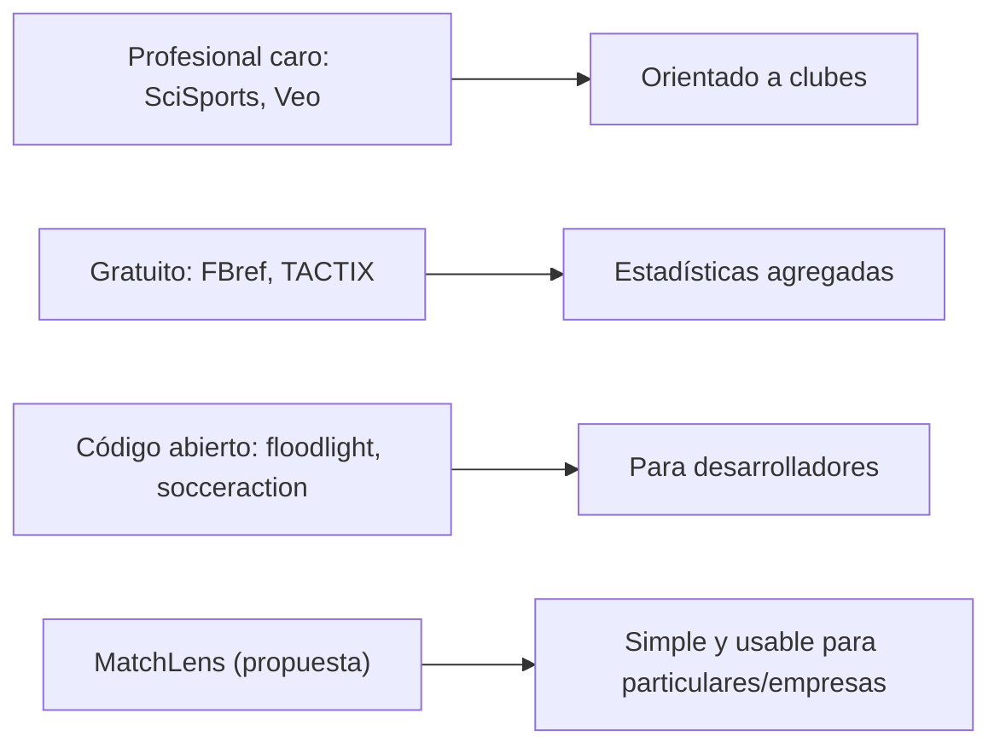

# 01b · Estado del arte (SOTA) de mi proyecto

> **Plantilla.** En **H1 (26-nov-2026)** entregas una **versión breve** (2-3 páginas: apartados **1, 2 y 5**), junto al `01-analisis.md`. Los apartados 3, 4, 6, 7 y 8 se completan en **H2 (21-ene-2027)** hasta las **4-6 páginas** del documento final. Aquí estudias qué soluciones, **modelos de negocio** y **herramientas** existen ya para el problema que has elegido, y justificas tus decisiones con ello. Cada apartado indica el criterio de evaluación (CE) que alimenta. Borra los bloques «Guía» al rellenar.

## 1. Problema y preguntas de búsqueda (CE 1c)

**Problema:** las aplicaciones de análisis de partidos de fútbol suelen ser complejas de entender y de utilizar.

| # | Pregunta | Dónde busqué | Fecha |
|---|---|---|---|
| P1 | ¿Qué soluciones existen para analizar partidos de fútbol (clubes, medios, particulares)? | Google (búsquedas en español e inglés), páginas de producto de proveedores, GitHub (topics `football-analytics`) | 2026-11-19 |
| P2 | ¿Cómo ganan dinero esas soluciones (suscripción, freemium, licencia, hardware)? | Páginas de precios y producto de los proveedores; artículo de FSI Training sobre software de análisis | 2026-11-19 |
| P3 | ¿Qué tecnologías y fuentes de datos usan (APIs, datasets, código abierto)? | Repositorios de GitHub (floodlight, kloppy, socceraction), documentación de proveedores | 2026-11-19 |
| P4 | ¿Qué hueco deja la competencia para un proyecto con enfoque en usabilidad? | Comparativa de las soluciones anteriores | 2026-11-19 |

## 2. Soluciones existentes (CE 1a, 1c, 2a)

Tabla de soluciones que resuelven total o parcialmente el problema. Incluye alternativas gratuitas, de código abierto y no digitales.

| Solución | Para quién | Qué hace | Modelo de precio | Enlace y fecha de acceso | Estado |
|---|---|---|---|---|---|
| SciSports (web app para clubes) | Clubes profesionales y academias | Match analysis, scouting y player profiles; une datos de evento, tracking y vídeo | No publicado; contacto/demo | https://www.scisports.com/clubs/ (2026-11-19) | leído |
| Veo Analytics 2 | Academias y clubes amateur/semi-pro | Estadísticas, heat maps, pass maps, coach assist (IA) a partir de vídeo grabado; hardware + software | Hardware 800–4.000 € + suscripción anual 800–2.500 € (aprox., según FSI Training) | https://www.veo.com/en-us/product/veo-analytics-2 (2026-11-19) | leído |
| FBref | Aficionados, periodistas, analistas | Estadísticas de jugadores, equipos y partidos de 100+ competiciones; xG | Gratuito; Stathead de pago | https://fbref.com/en (2026-11-19) | leído |
| TACTIX | Aficionados y analistas | Ratings transparentes, tablas, xG, forma, H2H, previas de partidos | Gratuito; tier Pro con más funciones | https://tactix.football/free-football-stats (2026-11-19) | leído |
| floodlight (código abierto) | Analistas de datos y desarrolladores | Paquete Python para análisis de tracking y event data; modelos espaciales | Gratuito, código abierto (MIT) | https://github.com/floodlight-sports/floodlight (2026-11-19) | leído |
| socceraction (código abierto) | Investigadores y analistas | Convierte event stream a SPADL; implementa VAEP y xT | Gratuito, código abierto (MIT) | https://github.com/ml-kuleuven/socceraction (2026-11-19) | leído |
| Hoja de cálculo (Excel / Google Sheets) | Cualquier usuario | Análisis manual de estadísticas copiadas de otras fuentes | Gratuito (Sheets) / licencia Office | no aplica (solución no digital) | n/a |
| Cuaderno / papel | Entrenadores y analistas en directo | Anotación manual de eventos y observaciones durante el partido | Gratuito | no aplica (solución no digital) | n/a |

*Figura: posicionamiento (complejidad/coste vs tipo de usuario).*

## 3. Modelos de negocio (CE 1d, 1e)

**Pendiente (H2).** A completar tras el estudio de soluciones del apartado 2. Hipótesis inicial: suscripción/freemium para particulares; licencia o contrato para clubes/medios. Por confirmar con datos.

| Patrón | Soluciones que lo usan | Ventaja | Riesgo |
|---|---|---|---|
| [RELLENAR] | | | |

## 4. Herramientas y tecnologías (CE 2a, 2b)

*Para cada decisión técnica importante (lenguaje y *framework*, base de datos, despliegue, autenticación…), compara **2-3 opciones con los mismos criterios**. Marca la que eliges.*

| Decisión | Opción | Madurez | Licencia | Coste | Curva de aprendizaje | Encaje con el ciclo | Elegida |
|---|---|---|---|---|---|---|---|
| [RELLENAR: p. ej. base de datos] | | | | | | | |

*Cada decisión importante se convierte en una decisión registrada en `decisiones/` (la plantilla llega con el bloque de H2).*

## 5. Hueco y diferenciación (CE 1e)

Las soluciones profesionales (SciSports, Veo) son caras y están orientadas a clubes con personal técnico. Las gratuitas (FBref, TACTIX) ofrecen estadísticas agregadas, pero no análisis táctico ni una experiencia pensada para el usuario no experto. Las de código abierto (floodlight, socceraction) son para desarrolladores y analistas de datos, no para usuarios finales. El hueco: una aplicación simple y usable para particulares y empresas pequeñas, que muestre las métricas básicas de un partido de forma clara, sin la complejidad de las herramientas profesionales. MatchLens se posiciona como complemento para usuarios no expertos; si existen soluciones mejores para analistas avanzados, se reconocerá.

## 6. Decisiones derivadas (CE 1e, 1f, 2b)

- **Tipo de proyecto elegido** (enlaza con apartado 3 de `01-analisis.md`): aplicación web de análisis de partidos de fútbol con enfoque en usabilidad.
- **Requisitos que salen del estudio:** RF-03 (integración de datos), RNF-01..03 (rendimiento, responsive, accesibilidad). Ver `01-analisis.md` §4.
- **Decisiones técnicas:** ver tabla del apartado 4; decisiones registradas en `decisiones/` pendientes de crear.

## 7. Fuentes y calidad (CE 2a)

**Pendiente (H2).** Al menos 2 fuentes independientes con enlace, fecha de acceso y fiabilidad. A completar tras la búsqueda del apartado 1.

| # | Fuente (enlace) | Tipo | Fecha de acceso | Fiabilidad |
|---|---|---|---|---|
| F1 | [RELLENAR] | | | |

## 8. Límites

- Las soluciones y precios (Veo) se tomaron de una fuente secundaria (FSI Training) y de las páginas de producto; los precios exactos no se verificaron con el proveedor.
- SciSports no publica precios en su web (solo contacto/demo).
- Las soluciones de código abierto se verificaron en GitHub, pero no se probaron.
- FBref y TACTIX son gratuitas con tiers de pago; las funciones exactas del tier de pago no se verificaron.
- No se incluyeron soluciones no digitales más allá de hoja de cálculo y papel.

---

## Criterios de evaluación que alimenta este documento (texto literal)

- **1a)** Se han clasificado las empresas del sector por sus características organizativas y el tipo de producto o servicio que ofrecen.
- **1c)** Se han identificado las necesidades más demandadas a las empresas.
- **1d)** Se han valorado las oportunidades de negocio previsibles en el sector.
- **1e)** Se ha identificado el tipo de proyecto requerido para dar respuesta a las demandas previstas.
- **1f)** Se han determinado las características específicas requeridas al proyecto.
- **2a)** Se ha recopilado información relativa a los aspectos que van a ser tratados en el proyecto.
- **2b)** Se ha realizado el estudio de viabilidad técnica del mismo.

> El SOTA **no añade criterios de evaluación**: reúne en un solo sitio lo que 1a-1f y 2a-2b ya piden. La evaluación sigue las listas de cotejo de H1 y H2.
